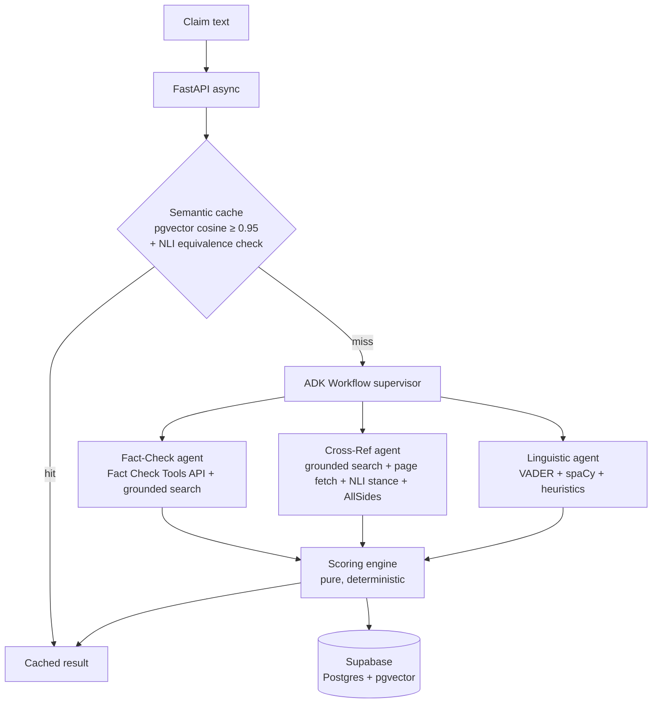

# VeriFact AI

> Multi-agent AI pipeline that turns a suspicious claim into a visual, source-backed credibility score. Parallel fact-check, cross-reference and linguistic agents feed a deterministic scoring engine that shows its work. **Not a chatbot.**

<p>
  
  
  
  
  
</p>

---

## Why this exists

Misinformation spreads roughly **6× faster** than corrections. Existing tools are either academic-grade text reports nobody reads on their phone, or chatbot wrappers around a single LLM that *hallucinate confidence without citing sources*.

VeriFact AI takes a different approach: a **multi-agent verification pipeline** that decomposes credibility into measurable signals, scores each independently, and shows its work. When it doesn't have enough evidence, it says so instead of fabricating certainty.

## What it does

- **Text input today.** URL and screenshot (OCR) input are designed but not built (Plan 8, runs last).
- **Composite trust score (0–100)** with a transparent breakdown, not a black-box verdict.
- **Citations for everything**: which fact-check matched, which outlets corroborated or refuted, what linguistic patterns were detected.
- **Honest confidence.** The UI shows "Not enough evidence" instead of a number when nothing backs the score.
- **Political bias labels from static AllSides data only.** The LLM never generates one.
- **Graceful degradation.** A failed or slow agent becomes a neutral result flagged "Partial analysis". If all three fail, nothing is scored.

## How it works



The pipeline is a Google ADK 2.x `Workflow` graph: `cache_lookup → dispatch_agents → score`. The supervisor runs the three workers concurrently as dynamic child nodes. A worker that raises or times out is mapped to its neutral result with `degraded=True`; its siblings finish and the run continues.

The Fact-Check and Cross-Ref workers are ADK `LlmAgent`s on Gemini: the model chooses its tool calls, inside hard per-tool caps, a model-turn cap and a config-backstop timeout. Everything around the model is deterministic: the supervisor, each agent's `finalize()` step and the scoring engine.

### The trust score

```
C_total = w1·S_fact + w2·(1 − B_ling) + w3·V_consensus        w = (0.50, 0.20, 0.30)
```

| Signal | Meaning | Source |
|--------|---------|--------|
| **S_fact** | Fact-check match score | Google Fact Check Tools API, then Google Search grounding scoped to fact-check domains |
| **B_ling** | Linguistic volatility (clickbait, emotion, sensationalism, density) | VADER + heuristics |
| **V_consensus** / **V_refute** | Reputable-source support and refutation, stance judged by a local NLI model | Grounded search + page fetch + `nli-deberta-v3-small` + AllSides |

The scoring engine is **pure and deterministic** (`Σw = 1.0`, `w1 ≥ 0.4`, output clamped to `[0,1]`) and applies four ordered cap rules: a definitive false verdict, a disputed claim, partial analysis, and low evidence. The binding rule is reported with the result.

## Tech stack

| Layer | Choice |
|-------|--------|
| Backend | Python 3.12+, FastAPI (async), managed with [`uv`](https://docs.astral.sh/uv/) |
| Agents | Google ADK 2.12, native Gemini (`gemini-3.1-flash-lite`), model set by config |
| Search | Gemini Google Search grounding; Google Fact Check Tools API |
| Local models | `cross-encoder/nli-deberta-v3-small` (stance, cache equivalence), `all-MiniLM-L6-v2` embeddings (384-dim; dimension is a config var), spaCy `en_core_web_sm` |
| Database | Supabase (Postgres + pgvector) |
| Frontend | Vite + React + Tailwind + Recharts, "Midnight Transit Diagram" design (see [`DESIGN.md`](DESIGN.md)) |
| Eval | Replay harness, DeepEval faithfulness guardrail, ADK eval over pipeline traces |

## Project structure

```
backend/app/{api,agents,scoring,services,db,utils}   # FastAPI + ADK pipeline
backend/verifact/                                    # `adk web` entry point
frontend/src/{pages,components,hooks,lib,fixtures}   # React dashboard
eval/                                                # harness, metrics, guardrails, datasets
data/AllSides/                                       # AllSides ratings and domain mapping
documents/                                           # PRD, TDD, build order
docs/superpowers/{specs,plans}/                      # design briefs and implementation plans
```

## Getting started

### Prerequisites

- Python 3.12+ and [`uv`](https://docs.astral.sh/uv/getting-started/installation/)
- Node 20+ for the frontend
- A Supabase project with pgvector. Apply `backend/app/db/migrations/*.sql` by hand, in order.
- Free-tier API keys: [Google AI Studio (Gemini)](https://aistudio.google.com/) and [Google Fact Check Tools](https://developers.google.com/fact-check/tools/api)

### Backend

```bash
cp .env.example .env        # then fill in your keys
cd backend
uv sync
uv run uvicorn app.main:app --reload
curl localhost:8000/health  # → {"status":"ok"}
```

Run the tests with `uv run pytest` from `backend/`. Live-API tests are deselected by default. More in [`backend/README.md`](backend/README.md).

### Frontend

```bash
cd frontend
cp .env.example .env        # for local dev set VITE_API_BASE_URL=http://localhost:8000
npm install
npm run dev                 # http://localhost:5173
npm test
npm run build
```

`VITE_API_BASE_URL` empty means the app calls `/api/...` on its own origin. Never put secrets in it: `VITE_*` values are bundled into the client.

In dev mode, append `?fixture=<name>` to preview a state without the backend: `fact_checked`, `corroborated`, `disputed_capped`, `unverified`, `partial`, `cached`, `legacy` or `long_claim`.

### Evaluation

```bash
# from the repo root; replay mode is free and reproducible
uv run --project backend python -m eval.run_eval --replay replay
uv run --project backend pytest eval/tests
```

`--replay record` and `--replay live` spend free-tier quota (a cold claim costs about 8 Gemini requests). See [`eval/README.md`](eval/README.md).

## Project status

Built in phases; the plan index and statuses live in [`docs/superpowers/plans/README.md`](docs/superpowers/plans/README.md), and the order in the [realigned roadmap](docs/superpowers/specs/2026-10-15-realigned-roadmap-design.md).

- ✅ **Foundation and core pipeline** (Plans 1–6): scoring engine with confidence caps, stance-aware consensus, NLI-guarded semantic cache, ADK `Workflow` orchestrator, hardening, Google Search grounding, ADK-native worker agents.
- ✅ **Frontend MVP** (Plan 7): text input end to end, shareable result pages, recent-claims feed.
- ✅ **Latency controls** (Task A): per-agent thinking levels, model-turn caps, UTC date awareness.
- 🚧 **Evaluation** (Plan 9): harness, trace audit, faithfulness guardrail, latency and cache benchmarks are built and tested. **No valid baseline run exists yet**, so this repo publishes no accuracy or latency figures. The record run waits on free-tier quota.
- 🔜 **Agent ops** (Plan 10): request tracing, agent registry and governance map, shared Gemini quota counter, read API, Docker demo-on-demand. Designed, not started.
- 🔜 **URL and screenshot input** (Plan 8, last): scraper and Surya OCR.

## Design principles

- **Never fabricate certainty.** "Not enough evidence" is a correct answer.
- **Bias ratings come only from AllSides static data.** The LLM never generates a political label.
- **Secrets stay server-side**, loaded from `.env`; never exposed to the frontend or logged.
- **Agents degrade gracefully.** Partial results over crashes; never a score when all agents fail.
- **Numbers need a valid run.** An eval run with an empty replay cache or broken search is marked `INVALID_RUN` and cannot be published.

## Documentation

- [`documents/`](documents/): product requirements (PRD), technical design (TDD), build order, open-source stack and eval framework. These predate the Gemini and ADK-native rewrite; where they disagree with the code or with `docs/superpowers/specs/`, the specs and the code win.
- [`docs/superpowers/specs/`](docs/superpowers/specs/): design briefs and reviews.
- [`docs/superpowers/plans/`](docs/superpowers/plans/): implementation plans, with branching and PR rules.
- [`docs/demo/DEMO_VIDEO.md`](docs/demo/DEMO_VIDEO.md): requirements and shot list for the recorded demo.
- [`PRODUCT.md`](PRODUCT.md) and [`DESIGN.md`](DESIGN.md): product and visual-design briefs.

## Data & model licenses

| Component | License | Obligation |
|-----------|---------|-----------|
| AllSides Media Bias Ratings | CC BY-NC 4.0 | Visible attribution ("Media bias ratings: AllSides.com") in the UI source list and the README; **non-commercial only**, a commercial license is needed otherwise |
| Surya OCR model weights | Modified OpenRAIL-M | Free for research, personal use and small companies under the revenue cap in `MODEL_LICENSE`; re-check before any commercial use |
| cross-encoder/nli-deberta-v3-small | Apache-2.0 | Keep the notice |
| all-MiniLM-L6-v2 / BGE-M3 | Apache-2.0 / MIT | Keep the notice |
| LIAR / FEVER samples | Research datasets | Eval only; commit derived samples, not raw dumps |

Media bias ratings: AllSides.com.

## License

To be determined.
