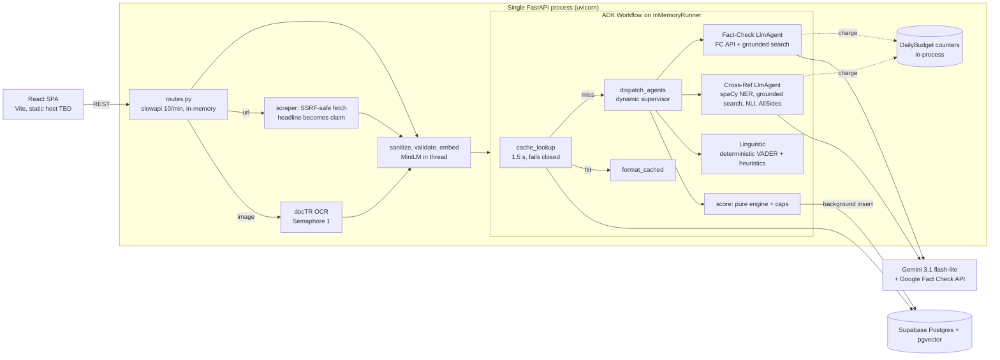

# VeriFact AI: Architecture & Agent-System Review

**Date:** 2026-11-15 · **Reviewer:** Claude (architect + agentic-architect skills) · **Branch:** `feat/ocr-url-input` @ `19d6201`
**Scope:** what is built (`backend/app`, `eval/`, `frontend/`) and what is planned (`documents/` TDD/PRD/Build Order, `docs/superpowers/specs/2026-10-15-realigned-roadmap-design.md`), including the serving strategy (TDD §10, roadmap R9 / Phase E).
**Basis:** inspected artifacts. Selective reading: the orchestrator, routes, lifespan, config, budgets, OCR and the deployment and security sections were read in full. The worker agents, cache and frontend were read only enough to check specific claims. No traces were inspected, and nothing was load-tested.

## Executive summary

- **Verdict:** the core is unusually sound for a portfolio project. It uses a deterministic ADK graph, LLMs only choose actions while code computes every number, it degrades honestly, and it has a strong eval and guardrail suite. **What is missing is everything after "it works on my machine."** There is no deployable artifact, no CI, no tracing, and the serving decision is still open.
- **Top risks:**
  1. **Nothing to deploy or gate.** There is no Dockerfile, compose file or CI workflow, although the TDD describes them (F1).
  2. **There is no per-run cap on LLM turns.** A model that keeps calling a refused tool burns the daily LLM budget until the 30 s timeout (F2).
  3. **Correctness depends on running exactly one process.** Budgets, the rate limiter, the ADK runner and background persistence are all in-process, and no serving config enforces a single process (F3).
- **Top recommendations:**
  1. Pick a single always-on host and ship a container with one worker (ADR below).
  2. Cap model turns per agent run.
  3. Add one CI job that runs the unit tests and the offline eval/guardrail suite.

## Context & yardstick

The product is a public, single-region demo that serves a portfolio. It has anonymous users and low volume, bounded by the daily budgets: 900 LLM calls and 150 grounded searches per day. That works out to roughly 50 uncached verifications a day. PRD targets are a result in under 10 s, zero bias leakage, and no fabricated certainty. The team is one developer and the budget is free tier or near it.

**Assumptions:** peak load is under 1 request/s. Losing the demo for a few hours is acceptable, so availability is around 99%. No user accounts. English only.

## Current architecture (as found)

**Drift from the docs:**

- TDD §10 shows a `docker-compose.yml` and `backend/Dockerfile` that pass `GROQ_API_KEY`. Neither file exists, and Groq is tabled.
- The TDD §2 tree lists `Dockerfile` and `docker-compose.yml`. They are missing.
- TDD §4.1 says the orchestrator "dispatches to OCR/scraper first" and uses a "BGE-M3 embedding". In the code, OCR and scraping run in `routes.py` before `verify_claim`, and dev uses MiniLM.
- The roadmap's Phase D bullet still names Groq leaves (`verdict_extractor`, `claim_aligner`).

## Scorecard

| Pillar | Score | Justification |
|---|---|---|
| A1 Appropriateness of agency | 5 | A deterministic graph, two tool-using agents where judgment is needed, and deterministic linguistics. The multi-agent split is justified by parallelism and failure isolation, not aesthetics. |
| A2 Topology & control flow | 4 | The dynamic supervisor is the right ADK construct for partial failure, and the reason is documented. LLM turns per run are not capped (F2). |
| A3 Tool design | 5 | Read-only tools, per-run call limits, closures over run evidence, refusal messages the model can act on. |
| A4 Context, state & memory | 4 | Fresh session per request, deleted afterwards. No long-term memory, which is correct. The in-memory session store is acceptable only because nothing outlives a request. |
| A5 Models | 3 | `output_schema`, and the model id comes from config. One provider and one model with no fallback. The prod model is still TBD. |
| A6 Safety & security | 5 | Fenced untrusted text, SSRF guard with DNS-rebinding defence, RLS lockdown, AllSides-only bias. There is no lethal trifecta: no private data in context and no write tools. |
| A7 Human oversight | n/a | No side-effecting actions. A HITL step is correctly absent. |
| A8 Evaluation | 4 | MAE, calibration, recall, bias leakage, trace audit, DeepEval faithfulness, replay with a frozen dataset hash. Nothing gates on it yet (F1). |
| A9 Observability & cost | 2 | Logging only. No tracing, no request id, no measured cost per request (F6). |
| A10 Reliability & ops | 3 | Timeouts and honest degradation are good. The 30 s backstops are far from the 10 s target, and in-process state is fragile (F3, F5). |
| P Data | 4 | Clear ownership, RLS, retention purge, embedding dimension in config, TTL and equivalence-gated cache. |
| P Security | 4 | See A6. CORS defaults to localhost and must be set for production. |
| P Delivery & change | 1 | No container, no CI, no deploy. The eval suite doesn't gate anything (F1). |
| P Cost efficiency | 4 | Hard daily budgets, flash-lite, a semantic cache. Budgets reset on restart (F3). |
| P Evolvability | 4 | Leaves before the hub, typed contracts, one seam for model patching. The ADK pin `<2.13` is a known upgrade tax. |

## Findings

### [F1] Nothing deployable, and no CI to gate evals (High)

- **Pillar:** Delivery, A8.
- **Evidence:** `backend/Dockerfile`, `docker-compose.yml` and `.github/` don't exist, but TDD §2 and §10 describe them. R9 (the deployment target) is still open in the roadmap spec. A very large eval suite (`eval/tests/*`) runs only when someone runs it by hand.
- **Impact:** the PRD's demo goal can't be met. Regressions in scoring or guardrails can merge unnoticed. The "agent ops" story in the roadmap has nothing to stand on.
- **Recommendation:**
  - Add a multi-stage Dockerfile: uv sync, then model weights baked into the image, then a non-root runtime.
  - Add a GitHub Actions job that runs `uv run pytest` plus the offline eval guardrails, which replay recorded evidence and need no live keys.
  - Mark live-API tests as excluded. The repo already has a live-API marker.
- **Effort:** M.

### [F2] No per-run cap on LLM turns (High; fixed 2026-11-15)

> **Fix applied:** `common.cap_model_turns` is a per-agent-build `before_model_callback` that runs ahead of `charge_llm_budget`, so a refused turn is never charged. It enforces `settings.max_model_turns_per_agent` (default 6) and raises `ModelTurnLimitExceeded`, which is classified as `PARSE_ERROR` and degrades the agent. Tests are in `tests/test_budget.py` and `tests/test_factcheck_agent.py`.

- **Pillar:** A2, A9, cost.
- **Evidence:** `orchestrator.py:324` calls `runner.run_async(...)` with no `run_config`. The installed ADK 2.12 `RunConfig.max_llm_calls` (`google/adk/agents/run_config.py:264`) falls back to its default (`ADK_MAX_LLM_CALLS`, else 500). Tool call limits (`factcheck_agent.py:184`, `crossref_agent.py:175`) refuse further tool calls, but they don't stop the model asking again. `charge_llm_budget` charges every turn.
- **Impact:** one misbehaving request can loop for the whole `agent_timeout_s` (30 s) on each of two agents. At flash-lite speed that could be dozens of calls taken from a 900/day budget, and the result is still a degraded answer. A small number of such claims, adversarial or accidental, can exhaust the day's budget for every user.
- **Recommendation:** count turns per run inside the existing `before_model_callback`. Raise once an agent passes N turns, where N is about the tool limit plus 2, so around 4–6. Alternatively pass `RunConfig(max_llm_calls=...)`, but that cap covers the whole invocation, so a per-agent counter is more precise. Add a test that uses the scripted LLM to keep calling a refused tool, and record turns-per-agent in the trace eval.
- **Effort:** S.

### [F3] Correctness silently depends on exactly one process (Medium)

- **Pillar:** Reliability, cost, serving.
- **Evidence:**
  - `services/budget.py`: `DailyBudget` keeps its counters in memory. The docstring says so.
  - `api/routes.py:23`: the slowapi `Limiter` uses default in-memory storage.
  - `orchestrator.py:303`: a process-wide `InMemoryRunner`.
  - `_background_tasks`: persistence writes that are drained on shutdown.
- **Impact:**
  - `uvicorn --workers 4`, or a platform that autoscales to more than one instance, multiplies the spend ceilings and rate limits by N, and also multiplies the ~2 GB of model RAM.
  - Every restart resets the day's budget to zero. Crash loops and redeploys make this worse.
  - A scale-to-zero platform kills in-flight background writes and pays a model-load cold start on every wake-up.
- **Recommendation:** make single-process an explicit, enforced deployment invariant: one uvicorn worker, max instances = 1, and a note in TDD §10. If the project ever needs more than one instance, move the budget counters to Supabase (an upsert of one row per day and counter) and the limiter to Redis, or to a Postgres-backed store.
- **Effort:** S now, M later.

### [F4] An OCR timeout frees the queue slot while inference is still running (Low; fixed 2026-11-15)

- **Pillar:** Reliability.
- **Evidence:** `ocr_agent.py`. `asyncio.wait_for(asyncio.to_thread(_recognize, img), ...)` times out, but the thread can't be cancelled, so it keeps running, and the `finally` then released `_QUEUE`.
- **Impact:** `_INFER_LOCK` inside `_recognize` still serialized inference, so memory was never multiplied. *This corrects the first draft of this review.* The real effect: the next upload took a default-executor thread that sat blocked on the lock, and its own `ocr_timeout_s` absorbed the previous inference. That produced false "took too long" errors under a burst.
- **Fix applied:** after a timeout or cancellation, the slot is released by a done-callback on the inference future. The callback is bound to the semaphore that was acquired. Tests are in `tests/test_ocr_agent.py`.
- **Effort:** S.

### [F5] Latency backstops are far from the product target (Medium)

- **Pillar:** Requirements fit.
- **Evidence:** `config.py:52,55`: `request_deadline_s=35`, `agent_timeout_s=30`. The PRD target is under 10 s. The latency re-bench is still open in memory notes, and TDD §4.1 says the values are "TBD from benchmarking".
- **Impact:** in the worst case a user waits 30–35 s. On a cold host, model loading comes first. The demo fails the headline claim it advertises.
- **Recommendation:** run `eval/latency_bench.py --live` on the chosen host, not the laptop, and set `agent_timeout_s` to about p95 plus a margin. Also report p50/p95 in the README. Do this after F1, because host CPU changes the NLI and spaCy cost.
- **Effort:** S.

### [F6] No tracing, request id or cost-per-request measurement (Medium)

- **Pillar:** A9, operability.
- **Evidence:** no OpenTelemetry, request id or structured logging anywhere in `app/`. This is planned as Phase E.
- **Impact:** after deployment, a "Partial Analysis" result can't be explained after the fact, and budget burn can't be attributed to individual requests.
- **Recommendation:** do the minimum first. Add a request id middleware, put the id in logs and in the stored `agent_outputs`, and log turns, tool calls and tokens per agent. ADK already emits events for this. Add OTel export once the host is chosen.
- **Effort:** M.

### [F7] Single model provider with no fallback (Low, accepted)

- **Pillar:** A5.
- **Evidence:** both `model_id` and `search_model_id` are `gemini-3.1-flash-lite` (`config.py:23,26`).
- **Impact:** a Gemini outage or quota error degrades both LLM agents, so results would carry only linguistic evidence. The caps make that honest, but it isn't useful to the user.
- **Recommendation:** accept for v2 and record it in an ADR. If added, the fallback must be eval-gated, because search grounding is Gemini-specific.
- **Effort:** n/a.

### [F8] Supabase pause and keep-alive aren't implemented, and `/health` doesn't touch the DB (Low)

- **Pillar:** Operability.
- **Evidence:** TDD §10 describes a daily keep-alive cron, which doesn't exist. `main.py:132` returns a static response.
- **Impact:** the first demo after a quiet week fails cache lookups. They fail closed, so the run is slow but correct. Writes fail.
- **Recommendation:**
  - Add `/health/ready`, which runs a cheap DB query. Keep `/health` as liveness.
  - Ping `/health/ready` daily from CI cron.
- **Effort:** S.

### [F9] Doc drift in TDD §2, §4.1 and §10 and the roadmap Phase D (Low)

- **Evidence:** see "Drift from the docs" above.
- **Recommendation:** fix the docs when F1 lands. CLAUDE.md treats the docs as the source of truth, so stale docs mislead the agents that read them.
- **Effort:** S.

## Tool risk table

| Tool | R/W | Confirmation | Idempotent | Identity | Injection exposure | Notes |
|---|---|---|---|---|---|---|
| `search_fact_check_database` | R | n/a | yes | server API key | third-party ClaimReview fields, fenced | per-run call limit |
| `search_fact_check_sites` (grounded) | R | n/a | yes | server Gemini key | search snippets, fenced; answer text discarded | 1 call/run, daily search budget |
| `search_news_coverage` (grounded + page fetch) | R | n/a | yes | server key; SSRF-guarded fetch | fetched page text, fenced | stance from NLI, bias from AllSides only |
| Scraper (pre-pipeline, not a model tool) | R | n/a | yes | none | **attacker-controlled headline becomes the claim** | impact limited to score steering, because `finalize()` is deterministic |

**Lethal trifecta:** absent. The model context holds no private data, and no tool writes or sends anything. The worst injection outcome is a manipulated query or decision, and `finalize()` validates that against what the tools returned. The adversarial eval cases check this.

## Eval coverage note

**Measured today:**
- MAE and bucketed accuracy
- calibration
- retrieval recall
- bias leakage, a zero-tolerance metric
- guardrails (capping, rejection)
- cache safety and honesty
- trace audit of the fixed path
- DeepEval faithfulness
- frozen dataset integrity

**Not measured:**
- turns per agent and tokens per request (F2, F6)
- latency on the target host (F5)
- online, production-trace quality
- OCR and URL input accuracy on a labelled set

None of these metrics gate a merge yet (F1).

## Serving strategy

**Constraints:**
- About 2 GB RAM for the base stack (torch, MiniLM, NLI, spaCy), more with docTR.
- In-process state, so one process is required (F3).
- Cold start loads models, which takes tens of seconds and up to about 80 s with an OCR download.
- Cost of about $0.
- The frontend is a static SPA.

| Option | Fit | Main cost |
|---|---|---|
| **(b) Always-free VM** (e.g. an ARM instance), Docker + Caddy TLS | Best. Always on, so no cold start; plenty of RAM; single process is natural. | You patch the OS. Capacity can be scarce at sign-up. |
| Cloud Run (or similar container platform), `min=1, max=1`, 2–4 GiB | Good. Managed TLS and logs, and Cloud Trace for Phase E. | `min=1` isn't free. `min=0` brings back cold starts and lost background writes (F3). |
| (a) HF Spaces PRO | OK. | Paid. The Space can sleep. Less control over proxy hops and CORS. |
| (c) Local demo plus a recording | Fallback only. | Fails the live-demo claim in the README. |

**Recommendation: (b)**, as one container with one uvicorn worker, model weights baked into the image, and `TRUSTED_PROXY_HOPS=1` behind Caddy. `CORS_ORIGINS` should be set to the static frontend's origin, with the frontend hosted on Vercel or Netlify. A GitHub Actions cron pings `/health/ready` (F8). Choose Cloud Run `min=1,max=1` instead if managed tracing for Phase E matters more than $0. Free-tier terms and prices change, so check them on the provider's page before committing; they weren't verified in this review.

### ADR-draft: Single-process, always-on backend for the demo

- **Status:** proposed (resolves roadmap R9 / TDD §10 open decision).
- **Decision:** run exactly one backend process on an always-on host, and enforce it in deployment config.
- **Why:** this keeps in-process budgets, the rate limiter, the runner and background writes correct with no new infrastructure (F3). It also avoids cold-start model loads (F5).
- **Gives up:** horizontal scale and zero-downtime deploys. A restart resets the budget counters, which is acceptable at demo volume.
- **Revisit when:** sustained traffic needs more than one instance, or budget accuracy across restarts matters. At that point, move the counters and limiter to shared storage.

## Strengths to preserve

- "The LLM chooses actions, code computes every number." `finalize()` builds results from recorded tool evidence, never from model text.
- The dynamic supervisor instead of fail-fast fan-out, documented with the ADK reason. Failed or timed-out agents become degraded neutral results.
- `AllAgentsFailedError` instead of a fabricated score, plus the confidence caps.
- SSRF defence: DNS-rebinding pinning, re-validation on every hop, NAT64 and IPv4-mapped handling.
- RLS lockdown with no policies, and revoked `EXECUTE` on RPCs.
- The cache is gated by NLI equivalence plus TTL, and fails closed.
- The streaming upload cap is enforced before parsing.
- An eval suite with integrity checks (frozen labels, offline guard, honest benches), which is rare at this stage.

## Roadmap

| When | Items |
|---|---|
| **Now** | F2 (turn cap, S), F4 (OCR semaphore, S), F1 (Dockerfile + CI, M) |
| **Next** (Phase E) | Choose the host (ADR above), deploy, then F5 (bench on the host, retune timeouts), F8 (readiness + keep-alive), F6 (request id, then OTel), F9 (doc sync) |
| **Later** | Shared budget and limiter storage, only if going multi-instance; model fallback (F7); online trace-quality monitoring; OCR/URL labelled eval set |

## Open questions

- Does the live demo need to cost exactly $0, or is a small monthly spend acceptable? The answer decides between the VM and Cloud Run `min=1`. This is for the project lead.
- What is the production model? Its latency and price change F5 and the budget defaults.

## Docs verified

- ADK `RunConfig.max_llm_calls` and its default came from the **installed `google-adk` 2.12.0 source** (`google/adk/agents/run_config.py`, `invocation_context.py`), not from adk.dev. The adk.dev pages weren't fetched, to save tokens.
- The dynamic-supervisor claims rest on the project's own TDD §4.1 citation (adk.dev/graphs/dynamic) and were not re-checked.
- Hosting-platform claims are carried over from TDD §10, which says it was verified in 2026-09, and were not re-checked.
